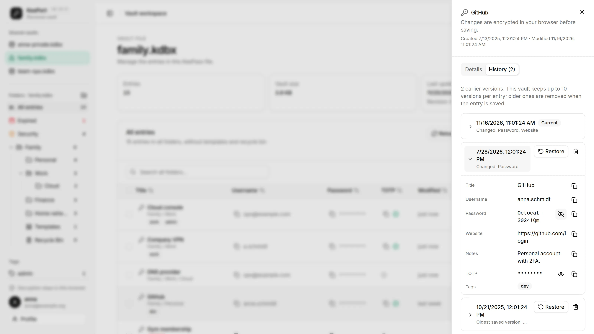
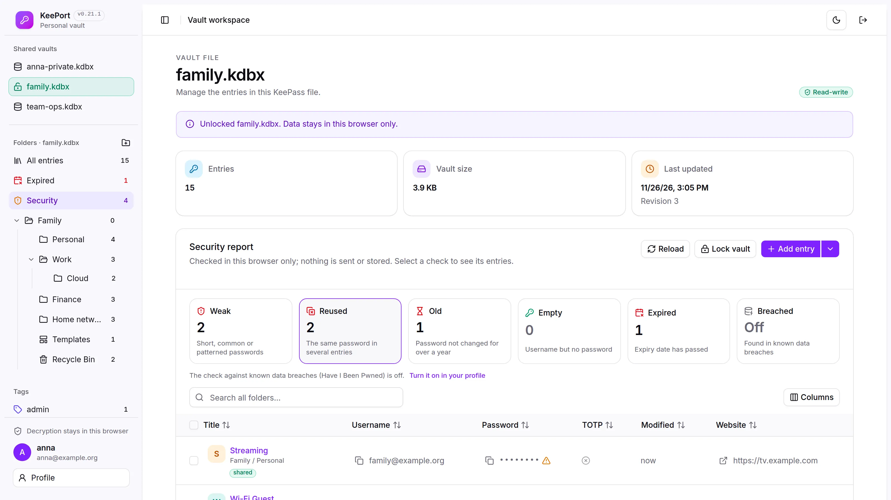
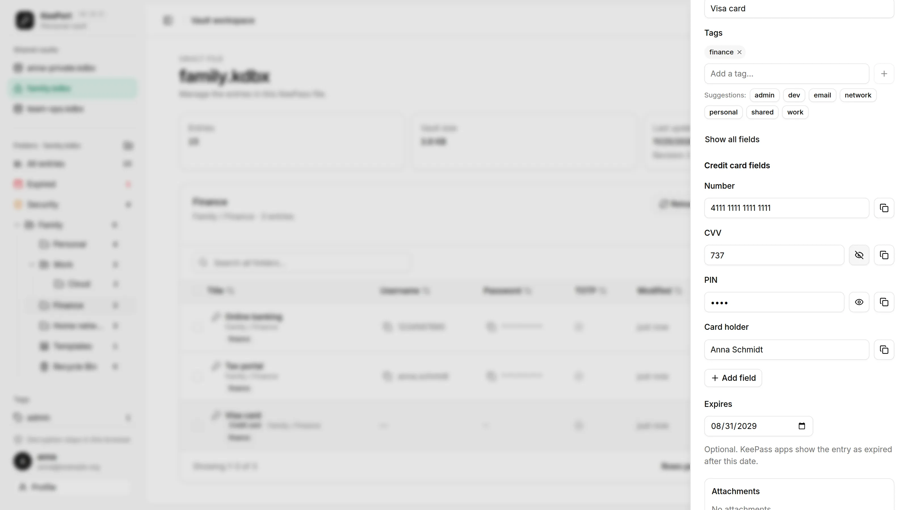
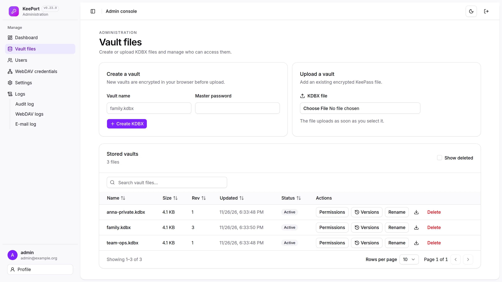
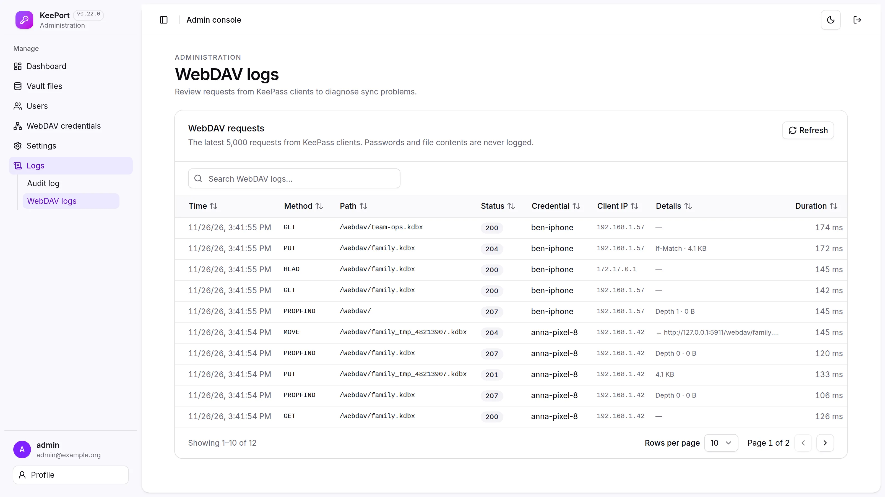
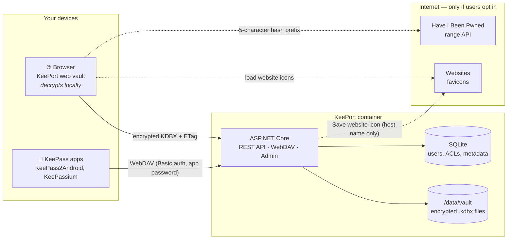

<div align="center">

# 🔐 KeePort

**Your KeePass vaults, self-hosted. Open them in the browser, sync them to your phone, share them with your family or team — without the server ever seeing a single password.**

[](https://github.com/madcoda9000/KeePort/releases)
[](LICENSE)
[](https://dotnet.microsoft.com/)
[](https://react.dev/)
[](#-quickstart)
[](#-compatibility)

[Quickstart](#-quickstart) · [Features](#-features) · [Screenshots](#-screenshots) · [How it works](#-how-it-works) · [📖 User manual](https://github.com/madcoda9000/KeePort/wiki) · [Deployment guide](docs/DEPLOYMENT.md) · [Changelog](CHANGELOG.md)

<br>

<picture>
  <source media="(prefers-color-scheme: dark)" srcset="docs/images/vault-entries-dark.webp">
  
</picture>

</div>

> [!NOTE]
> KeePort is in **beta** (`v0.21.0`). Keep regular backups of your `.kdbx` files and of the `/data` volume.
>
> The **[user manual](https://github.com/madcoda9000/KeePort/wiki)** in the wiki explains every page of the admin console and the web vault step by step.

---

## ✨ Why KeePort?

KeePass files are great: open format, strong encryption, dozens of apps. Keeping them in sync across browser, phone and several people is not. KeePort is the missing piece in the middle:

- **One place for your `.kdbx` files** on your own NAS or server.
- **A web vault** that opens them in any modern browser — decryption happens on your device only.
- **WebDAV sync** for the KeePass apps you already use on Android, iOS and desktop.
- **Sharing with permissions** — give each person read or read-write access per vault.

## 🚀 Features

| | |
|---|---|
| 🧠 **Zero-knowledge web vault** | Unlock, search, edit and save KDBX files in the browser. Master passwords and key files never leave your device. |
| ⚡ **Everyday comfort** | Copy usernames, passwords and TOTP codes straight from the list, open entries with a double-click, choose the columns you see, generate passwords or passphrases, open websites, and have the clipboard cleared automatically. |
| 🔍 **Security report** | Finds weak, reused, old and empty passwords and expired entries — computed only in your browser — plus an opt-in check against Have I Been Pwned. |
| 🕘 **History & tags** | See every earlier version of an entry, restore one or delete old versions; tag entries and filter by tag — compatible with KeePass2Android, KeePassXC and KeePassium. |
| 📁 **Folders & recycle bin** | Browse the KDBX folder tree, create, rename and delete folders, move several entries at once, and delete to the recycle bin with restore — the structure stays the same in KeePassXC, KeePass2Android and KeePassium. |
| 🧾 **Templates, fields & icons** | Credit cards, IDs and other KeePass2Android templates show their own fields; add, edit and protect custom fields, set expiry dates, and store website icons in the vault so every KeePass app shows them. |
| 🔑 **Full KDBX support** | KDBX 3.1 and 4.x, Argon2id/AES-KDF, optional key files, attachments up to 10 MiB, and TOTP codes with live countdown. |
| 📱 **WebDAV for mobile apps** | Works with KeePass2Android and KeePassium, including transactional saves, conflict-safe sync and merging. |
| 👥 **Users & per-vault ACLs** | `read` or `read-write` per vault, enforced the same way in the API, web vault and WebDAV. |
| 🛡️ **No silent overwrites** | Every write is checked against the version the client last saw. Stale saves are kept as admin-only conflict copies. |
| ⏪ **Vault versions** | Every save keeps the previous state on the server; administrators can download or restore any of the last 30 versions (configurable) with one click. |
| 🧰 **Admin console** | A dashboard with status, storage, sign-ins and sync activity; manage vault files, users, permissions, WebDAV app passwords and rate limits; inspect WebDAV request logs. |
| 🔐 **Passkeys & two-factor sign-in** | Sign in with a passkey (fingerprint, face, PIN or security key) without a password, or add codes from an authenticator app (with QR code) or by e-mail, plus recovery codes; administrators can require it for admins or users and reset it for a lost phone. WebDAV app passwords keep working. |
| ✉️ **E-mail** | Optional SMTP: invite users so they choose their own password, “Forgot password?” links, confirmed addresses, security notifications and warnings for administrators — in English, German or French. |
| 📜 **Audit log** | Who signed in and who changed users, vaults, permissions and settings — with colour-coded action tags, filters, CSV export and configurable retention. Users see their own recent sign-ins. |
| 💾 **Crash-safe storage** | Atomic writes (temp file → fsync → rename), soft delete with restore, plain files in a host folder or Docker volume. |
| 🌍 **English, German, French** | The web vault and the admin console speak English, German and French; each user picks the language once and it follows them to every device. |
| 🐳 **One container** | Single Docker image with a persistent `/data` folder and a separate admin port served over HTTPS. |

## 📸 Screenshots

<table>
  <tr>
    <td width="50%">
      <picture>
        <source media="(prefers-color-scheme: dark)" srcset="docs/images/vault-entry-dark.webp">
        
      </picture>
      <p align="center"><b>Entry details & TOTP</b><br><sub>Edit entries and copy one-time codes — decrypted only in your browser.</sub></p>
    </td>
    <td width="50%">
      <picture>
        <source media="(prefers-color-scheme: dark)" srcset="docs/images/vault-history-dark.webp">
        
      </picture>
      <p align="center"><b>Entry history</b><br><sub>See what changed, view old values and restore any version.</sub></p>
    </td>
  </tr>
  <tr>
    <td width="50%">
      <picture>
        <source media="(prefers-color-scheme: dark)" srcset="docs/images/vault-security-dark.webp">
        
      </picture>
      <p align="center"><b>Security report</b><br><sub>Weak, reused and old passwords at a glance — checked only in your browser.</sub></p>
    </td>
    <td width="50%">
      <picture>
        <source media="(prefers-color-scheme: dark)" srcset="docs/images/vault-card-dark.webp">
        
      </picture>
      <p align="center"><b>Templates & custom fields</b><br><sub>Credit cards and other KeePass2Android templates show their own fields.</sub></p>
    </td>
  </tr>
  <tr>
    <td width="50%">
      <picture>
        <source media="(prefers-color-scheme: dark)" srcset="docs/images/admin-dashboard-dark.webp">
        
      </picture>
      <p align="center"><b>Admin dashboard</b><br><sub>Status, storage, sign-ins and sync activity at a glance.</sub></p>
    </td>
    <td width="50%">
      <picture>
        <source media="(prefers-color-scheme: dark)" srcset="docs/images/admin-vaults-dark.webp">
        
      </picture>
      <p align="center"><b>Vault files</b><br><sub>Create, upload, rename, restore and download KDBX files.</sub></p>
    </td>
  </tr>
  <tr>
    <td width="50%">
      <picture>
        <source media="(prefers-color-scheme: dark)" srcset="docs/images/admin-permissions-dark.webp">
        
      </picture>
      <p align="center"><b>Per-vault permissions</b><br><sub>Read only or read and write, per user and vault.</sub></p>
    </td>
    <td width="50%">
      <picture>
        <source media="(prefers-color-scheme: dark)" srcset="docs/images/admin-webdav-logs-dark.webp">
        
      </picture>
      <p align="center"><b>WebDAV logs</b><br><sub>See exactly what each KeePass app sends when syncing.</sub></p>
    </td>
  </tr>
</table>

<sub>Screenshots use fictional demo data. Light and dark versions follow your GitHub theme.</sub>

## ⚡ Quickstart

> [!TIP]
> **Running a Synology or QNAP NAS?** Follow the step-by-step guides for [Synology DSM](docs/DEPLOYMENT.md#-synology-dsm) and [QNAP](docs/DEPLOYMENT.md#-qnap-qts--quts-hero), including HTTPS with the NAS's built-in reverse proxy and backups.

**Requirements:** Docker with Compose v2.

```bash
# Check out the latest release (not the development branch)
git clone --branch v0.21.0 https://github.com/madcoda9000/KeePort.git
cd KeePort

cp .env.example .env
docker compose up -d --build

# One-time token for creating the first administrator
docker compose logs keeport | grep -i "setup token"
```

| What | Where |
|---|---|
| 🌐 Web vault | `http://<host>:8080` — use HTTPS via your reverse proxy to unlock vaults |
| 📂 WebDAV | `http://<host>:8080/webdav` |
| 🛠️ Admin console | **`https://<host>:8081/admin`** (self-signed certificate, LAN only) |

Open the admin console with **`https://`**. Your browser warns once about the self-signed certificate — accept it ([details](docs/DEPLOYMENT.md#the-admin-certificate-warning)). HTTPS is what lets the browser create encrypted vaults.

**First steps in the admin console:** create the administrator → create a user → create or upload a vault and grant access → create a WebDAV app password per device.

> [!CAUTION]
> The admin console listens on every network of the host by default — fine for a NAS behind your home router, but **never forward port `8081` or publish it through a reverse proxy**. On a server with a public IP (VPS), set `KEEPORT_ADMIN_BIND=127.0.0.1` in `.env` and use an SSH tunnel (`ssh -L 8081:127.0.0.1:8081 user@server`, then `https://localhost:8081/admin`) — Docker publishes ports past host firewalls such as `ufw` ([details](docs/DEPLOYMENT.md#who-can-reach-the-admin-console)).

> [!NOTE]
> Unlocking vaults in the web vault needs HTTPS (or `http://localhost`), because browsers only offer their encryption functions there. Publish the web vault through a reverse proxy with HTTPS; over plain `http://<ip>` KeePort shows a warning instead ([details](docs/DEPLOYMENT.md#-secure-connection-required)).

### Updating to a new release

```bash
cd KeePort
git fetch --tags
git checkout v0.21.0          # the release you want, see the Releases page
docker compose up -d --build
```

On a NAS, the update script does all of this for you, including a backup and an automatic rollback: `sudo bash keeport/scripts/keeport-update.sh` ([details](docs/DEPLOYMENT.md#-updating)).

Your data stays in the `keeport-data` volume (or the folder set in `KEEPORT_DATA`; **Admin → Settings → Data storage** shows which). Read the [changelog](CHANGELOG.md) before updating and [make a backup](docs/DEPLOYMENT.md#-backup--restore) first. NAS update steps are in the [deployment guide](docs/DEPLOYMENT.md#-updating).

## 🧩 How it works



- The server stores `.kdbx` files as **opaque encrypted blobs**. It never parses vault contents and never receives a master password or key file.
- Every vault has a **revision and an ETag**. A write is only accepted if it is based on the current version; otherwise the original stays untouched and the submitted file becomes a **conflict copy** for an administrator.
- WebDAV clients that do not send `If-Match` (such as KeePass2Android) are checked against the version their app password **last downloaded**, so they get the same protection.
- Website icons are **off by default**. Icons stored in the vault (for example by KeePassXC) are always shown. Users who switch on "Load website icons" let their browser fetch each site's favicon directly; the site then sees their IP address. The KeePort server never sees the URLs — except the host name of an entry for which a user clicks **Save website icon**: the server then downloads that icon once (public HTTPS sites only, never addresses in your network) and the browser stores it in the vault.
- The **breach check** against Have I Been Pwned is **off by default** and turned on per user. It uses k-anonymity: the browser sends only the first 5 characters of each password's SHA-1 hash and compares the rest locally. Neither the passwords nor the KeePort server are involved.

## 📱 Compatibility

| Client | Platform | Connection | Status |
|---|---|---|---|
| KeePort web vault | Any modern browser | Built in | ✅ Open, edit, save, delete, folders, tags, history, templates, custom fields, attachments, TOTP |
| [KeePass2Android](https://github.com/PhilippC/keepass2android) | Android | WebDAV | ✅ Save, sync and merge verified on a device |
| [KeePassium](https://keepassium.com/) | iOS / iPadOS | WebDAV | ✅ Edit and sync verified on a device |
| [KeePassXC](https://keepassxc.org/) | Desktop | File (download/upload) | ✅ KDBX files, TOTP and attachments verified with 2.7.6 |
| [KeePassDX](https://www.keepassdx.com/) | Android | WebDAV via a storage provider such as DAVx⁵ | ⚪ Expected to work, not yet verified |

Setup instructions per client are in the [deployment guide](docs/DEPLOYMENT.md#-connect-keepass-apps). If a client cannot save, **Admin → Logs → WebDAV logs** shows exactly which requests it sent.

## 🔒 Security model

- **Zero knowledge:** decryption, editing and re-encryption happen only in the browser or KeePass app.
- **Separate roles:** admin accounts can only use the admin console; the web vault and WebDAV require a regular user account.
- **Separate WebDAV credentials:** one app password per device, stored as an Argon2id hash and revocable at any time.
- **Hardened sessions:** `HttpOnly`/`SameSite` cookies, CSRF tokens, Argon2id password hashing and configurable per-IP rate limits for sign-in and WebDAV.
- **Two-factor sign-in:** passkeys (WebAuthn, phishing-resistant), optional or required TOTP or e-mail codes; TOTP secrets are encrypted at rest, a code works only once, recovery codes are stored as hashes.
- **Explicit proxy trust:** client addresses from `X-Forwarded-For` are only accepted from reverse proxies you list; catch-all entries are refused.
- **Admin isolation:** admin endpoints only answer on the admin port, which is served over HTTPS with a self-signed certificate created on first start.
- **Privacy-aware logging:** WebDAV logs record method, path, status and headers such as `If-Match`; the audit log records who did what to which user, vault or setting — never passwords, tokens or file contents.
- **Outside contact only on request:** website icons and the breach check are off until a user turns them on. Icon downloads by the server reach public HTTPS sites only — addresses in your network, loopback and reserved ranges are refused, also after redirects — and can be turned off with `KEEPORT_FAVICON_DOWNLOAD=false`.
- **Browser hardening:** a strict Content-Security-Policy, copied secrets cleared from the clipboard after 30 seconds (configurable) and when the vault locks, and auto-lock when the tab stays in the background.

Use HTTPS (for example behind a reverse proxy) before exposing the web vault or WebDAV beyond your LAN. The [deployment guide](docs/DEPLOYMENT.md) covers HTTPS with the Synology and QNAP reverse proxies as well as Caddy and nginx.

## ⚙️ Configuration

Copy `.env.example` to `.env` and adjust as needed:

| Variable | Default | Purpose |
|---|---|---|
| `KEEPORT_HTTP_HOST_PORT` | `8080` | Host port of the web vault and WebDAV (e.g. `8090` on QNAP, where QTS uses 8080). |
| `KEEPORT_DATA` | `keeport-data` | Docker volume name, or a folder path for a bind mount owned by UID 1000. |
| `KEEPORT_ADMIN_BIND` | `0.0.0.0` | Host address the admin port is published on; `127.0.0.1` on a VPS. |
| `KEEPORT_ADMIN_HTTPS` | `true` | HTTPS with a self-signed certificate for the admin console; `false` if a reverse proxy does TLS. |
| `KEEPORT_ADMIN_TLS_HOSTS` | *(empty)* | Extra names/IPs for the admin certificate, e.g. `192.168.1.20, nas.local`. |
| `KEEPORT_ADMIN_HOST_PORT` | `8081` | Host port of the admin console (the container side is always `8081`). |
| `KEEPORT_COOKIE_SECURE` | `false` | Set to `true` when KeePort is served over HTTPS. |
| `KEEPORT_TRUSTED_PROXIES` | *(empty)* | `gateway` for a reverse proxy on the same host (NAS proxy, Caddy, nginx), or the proxy's IP/network, so KeePort sees each device's own address ([details](docs/DEPLOYMENT.md#-trust-your-reverse-proxy)). |
| `KEEPORT_FAVICON_DOWNLOAD` | `true` | Allow "Save website icon": the server fetches a site's icon once (public HTTPS sites only). |

Sign-in and WebDAV rate limits are changed at runtime in **Admin → Settings**. Everything else — NAS setup, backups, reverse proxy examples, troubleshooting — is in the [deployment guide](docs/DEPLOYMENT.md).

## 🛠️ Development

```bash
# Backend with a local data directory (the default /data is meant for the container)
export KeePort__DataDir="$PWD/.data" KeePort__CookieSecure=false
dotnet run --project src/KeePort.Api

# Frontend dev servers
cd web/vault && npm install && npm run dev
cd web/admin && npm install && npm run dev

# Serve the built frontends from the backend
./scripts/build-web.sh
dotnet run --project src/KeePort.Api

# Tests and lint
dotnet test
node --test web/vault/src/lib/*.test.mjs web/shared/*.test.mjs
(cd web/vault && npm run lint) && (cd web/admin && npm run lint)
```

The web vault is served at `/`, the admin console at `/admin` and WebDAV at `/webdav`.

```text
src/KeePort.Api           ASP.NET Core backend: REST API, WebDAV, SQLite data layer
web/vault                 React + TypeScript web vault (shadcn/ui)
web/admin                 React + TypeScript admin console (shadcn/ui)
web/shared                Shared table components and helpers
tests/KeePort.Api.Tests   xUnit integration tests
scripts/                  build-web.sh, keeport-update.sh (NAS update with backup and rollback)
docs/                     Deployment guide and images
```

## 🗺️ Roadmap

- **Browser extension** — the backend already supports extra CORS origins via `KeePort:CorsOrigins`; a token-based sign-in for extensions is planned on top of the existing sessions.

Ideas and bug reports are welcome in the [issue tracker](https://github.com/madcoda9000/KeePort/issues).

## 📄 License

KeePort is released under the [MIT License](LICENSE). It includes the EFF Large Wordlist (CC BY 3.0, Electronic Frontier Foundation) and a list of common passwords from SecLists (MIT); see [THIRD-PARTY-NOTICES.md](THIRD-PARTY-NOTICES.md).
