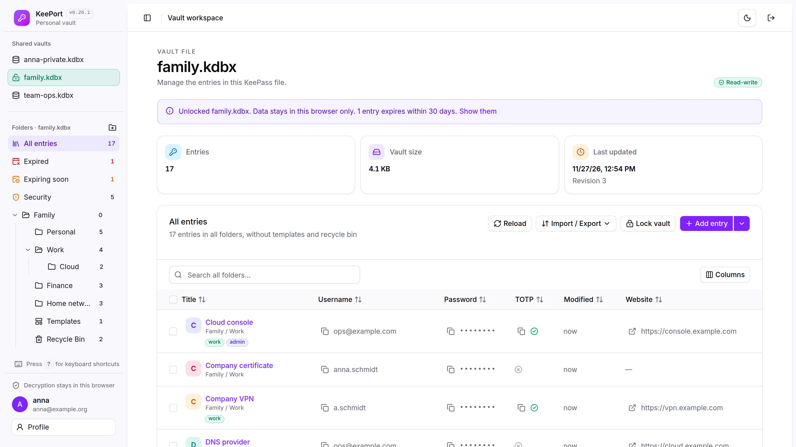
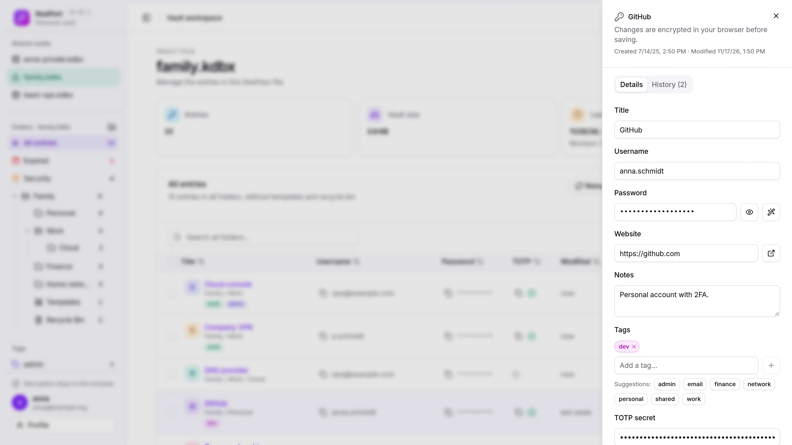
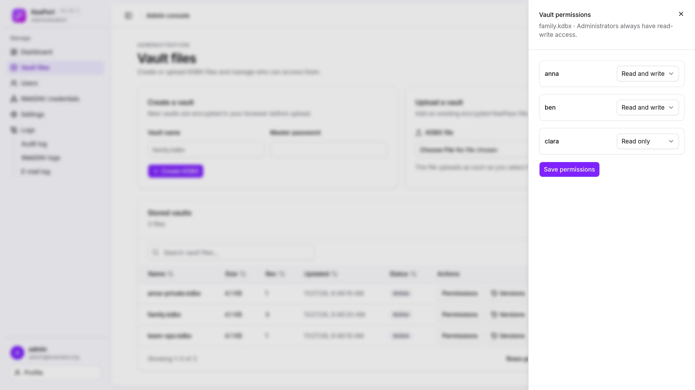
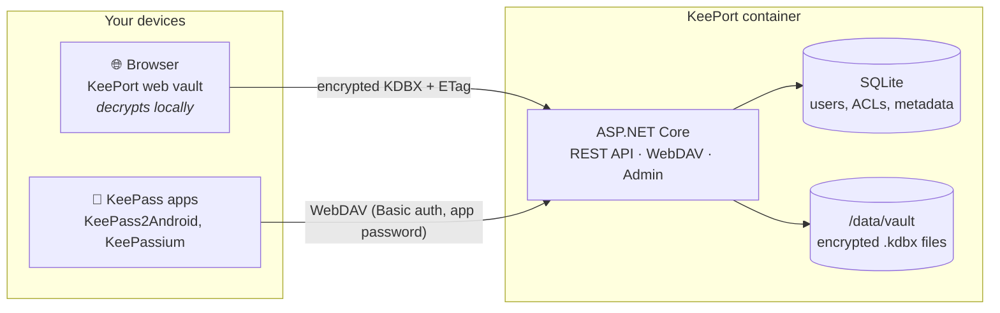

<div align="center">

# 🔐 KeePort

**Your KeePass vaults, self-hosted. Open them in the browser, sync them to your phone, share them with your family or team — without the server ever seeing a single password.**

[](https://github.com/madcoda9000/KeePort/releases)
[](LICENSE)
[](https://dotnet.microsoft.com/)
[](https://react.dev/)
[](#-quickstart)
[](#-compatibility)

[Quickstart](#-quickstart) · [Features](#-features) · [Screenshots](#-screenshots) · [How it works](#-how-it-works) · [Deployment guide](docs/DEPLOYMENT.md) · [Changelog](CHANGELOG.md)

<br>

<picture>
  <source media="(prefers-color-scheme: dark)" srcset="docs/images/vault-entries-dark.webp">
  
</picture>

</div>

> [!NOTE]
> KeePort is in **beta** (`v0.1.0`). Keep regular backups of your `.kdbx` files and of the `/data` volume.

---

## ✨ Why KeePort?

KeePass files are great: open format, strong encryption, dozens of apps. Keeping them in sync across browser, phone and several people is not. KeePort is the missing piece in the middle:

- **One place for your `.kdbx` files** on your own NAS or server.
- **A web vault** that opens them in any modern browser — decryption happens on your device only.
- **WebDAV sync** for the KeePass apps you already use on Android, iOS and desktop.
- **Sharing with permissions** — give each person read or read-write access per vault.

## 🚀 Features

| | |
|---|---|
| 🧠 **Zero-knowledge web vault** | Unlock, search, edit and save KDBX files in the browser. Master passwords and key files never leave your device. |
| 🔑 **Full KDBX support** | KDBX 3.1 and 4.x, Argon2id/AES-KDF, optional key files, attachments up to 10 MiB, and TOTP codes with live countdown. |
| 📱 **WebDAV for mobile apps** | Works with KeePass2Android and KeePassium, including transactional saves, conflict-safe sync and merging. |
| 👥 **Users & per-vault ACLs** | `read` or `read-write` per vault, enforced the same way in the API, web vault and WebDAV. |
| 🛡️ **No silent overwrites** | Every write is checked against the version the client last saw. Stale saves are kept as admin-only conflict copies. |
| 🧰 **Admin console** | Manage vault files, users, permissions, WebDAV app passwords, rate limits — and inspect WebDAV request logs. |
| 💾 **Crash-safe storage** | Atomic writes (temp file → fsync → rename), soft delete with restore, plain files on a Docker volume. |
| 🐳 **One container** | Single Docker image with a persistent `/data` volume and an optional, separately bound admin port. |

## 📸 Screenshots

<table>
  <tr>
    <td width="50%">
      <picture>
        <source media="(prefers-color-scheme: dark)" srcset="docs/images/vault-entry-dark.webp">
        
      </picture>
      <p align="center"><b>Entry details & TOTP</b><br><sub>Edit entries and copy one-time codes — decrypted only in your browser.</sub></p>
    </td>
    <td width="50%">
      <picture>
        <source media="(prefers-color-scheme: dark)" srcset="docs/images/admin-vaults-dark.webp">
        
      </picture>
      <p align="center"><b>Vault files</b><br><sub>Create, upload, rename, restore and download KDBX files.</sub></p>
    </td>
  </tr>
  <tr>
    <td width="50%">
      <picture>
        <source media="(prefers-color-scheme: dark)" srcset="docs/images/admin-permissions-dark.webp">
        
      </picture>
      <p align="center"><b>Per-vault permissions</b><br><sub>Read only or read and write, per user and vault.</sub></p>
    </td>
    <td width="50%">
      <picture>
        <source media="(prefers-color-scheme: dark)" srcset="docs/images/admin-webdav-logs-dark.webp">
        
      </picture>
      <p align="center"><b>WebDAV logs</b><br><sub>See exactly what each KeePass app sends when syncing.</sub></p>
    </td>
  </tr>
</table>

<sub>Screenshots use fictional demo data. Light and dark versions follow your GitHub theme.</sub>

## ⚡ Quickstart

**Requirements:** Docker with Compose v2.

```bash
# Check out the latest release (not the development branch)
git clone --branch v0.1.0 https://github.com/madcoda9000/KeePort.git
cd KeePort

cp .env.example .env
docker compose up -d --build

# One-time token for creating the first administrator
docker compose logs keeport | grep -i "setup token"
```

| What | Where |
|---|---|
| 🌐 Web vault | `http://<host>:8080` |
| 📂 WebDAV | `http://<host>:8080/webdav` |
| 🛠️ Admin console | `http://127.0.0.1:8081/admin` (local only, see below) |

The admin console is bound to `127.0.0.1` by default, so it is not reachable from your network. Open it through an SSH tunnel:

```bash
ssh -L 8081:127.0.0.1:8081 user@your-nas
# then open http://localhost:8081/admin and enter the setup token
```

**First steps in the admin console:** create the administrator → create a user → create or upload a vault and grant access → create a WebDAV app password per device.

> [!TIP]
> To reach the admin console from your LAN or VPN instead, set `KEEPORT_ADMIN_BIND` in `.env` to a LAN/VPN IP (or `0.0.0.0`) and run `docker compose up -d` again. Never expose port `8081` to the internet.

### Updating to a new release

```bash
cd KeePort
git fetch --tags
git checkout v0.2.0          # the release you want, see the Releases page
docker compose up -d --build
```

Your data stays in the `keeport-data` volume. Read the [changelog](CHANGELOG.md) before updating and [back up `/data`](docs/DEPLOYMENT.md#3-data-permissions-and-backups) first.

## 🧩 How it works



- The server stores `.kdbx` files as **opaque encrypted blobs**. It never parses vault contents and never receives a master password or key file.
- Every vault has a **revision and an ETag**. A write is only accepted if it is based on the current version; otherwise the original stays untouched and the submitted file becomes a **conflict copy** for an administrator.
- WebDAV clients that do not send `If-Match` (such as KeePass2Android) are checked against the version their app password **last downloaded**, so they get the same protection.

## 📱 Compatibility

| Client | Platform | Connection | Status |
|---|---|---|---|
| KeePort web vault | Any modern browser | Built in | ✅ Open, edit, save, attachments, TOTP |
| [KeePass2Android](https://github.com/PhilippC/keepass2android) | Android | WebDAV | ✅ Save, sync and merge verified on a device |
| [KeePassium](https://keepassium.com/) | iOS / iPadOS | WebDAV | ✅ Edit and sync verified on a device |
| [KeePassXC](https://keepassxc.org/) | Desktop | File (download/upload) | ✅ KDBX files, TOTP and attachments verified with 2.7.6 |
| [KeePassDX](https://www.keepassdx.com/) | Android | WebDAV via a storage provider such as DAVx⁵ | ⚪ Expected to work, not yet verified |

Setup instructions per client are in the [deployment guide](docs/DEPLOYMENT.md#5-webdav-for-mobiledesktop-keepass-clients). If a client cannot save, **Admin → Logs → WebDAV logs** shows exactly which requests it sent.

## 🔒 Security model

- **Zero knowledge:** decryption, editing and re-encryption happen only in the browser or KeePass app.
- **Separate roles:** admin accounts can only use the admin console; the web vault and WebDAV require a regular user account.
- **Separate WebDAV credentials:** one app password per device, stored as an Argon2id hash and revocable at any time.
- **Hardened sessions:** `HttpOnly`/`SameSite` cookies, CSRF tokens, Argon2id password hashing and configurable per-IP rate limits for sign-in and WebDAV.
- **Admin isolation:** admin endpoints only answer on the admin port when `KeePort:AdminPorts` is configured.
- **Privacy-aware logging:** WebDAV logs record method, path, status and headers such as `If-Match` — never passwords or file contents.

Use HTTPS (for example behind a reverse proxy) before exposing the web vault or WebDAV beyond your LAN. See [HTTPS and reverse proxy](docs/DEPLOYMENT.md#4-https-and-reverse-proxy).

## ⚙️ Configuration

Copy `.env.example` to `.env` and adjust as needed:

| Variable | Default | Purpose |
|---|---|---|
| `KEEPORT_ADMIN_BIND` | `127.0.0.1` | Host address the admin port is published on. |
| `KEEPORT_ADMIN_HOST_PORT` | `8081` | Host port of the admin console. |
| `KEEPORT_ADMIN_PORT` | `8081` | Container port that serves the admin API and UI. |
| `KEEPORT_COOKIE_SECURE` | `false` | Set to `true` when KeePort is served over HTTPS. |

Sign-in and WebDAV rate limits are changed at runtime in **Admin → Settings**. Everything else — backups, reverse proxy examples, troubleshooting — is in the [deployment guide](docs/DEPLOYMENT.md).

## 🛠️ Development

```bash
# Backend with a local data directory (the default /data is meant for the container)
export KeePort__DataDir="$PWD/.data" KeePort__CookieSecure=false
dotnet run --project src/KeePort.Api

# Frontend dev servers
cd web/vault && npm install && npm run dev
cd web/admin && npm install && npm run dev

# Serve the built frontends from the backend
./scripts/build-web.sh
dotnet run --project src/KeePort.Api

# Tests
dotnet test
```

The web vault is served at `/`, the admin console at `/admin` and WebDAV at `/webdav`.

```text
src/KeePort.Api           ASP.NET Core backend: REST API, WebDAV, SQLite data layer
web/vault                 React + TypeScript web vault (shadcn/ui)
web/admin                 React + TypeScript admin console (shadcn/ui)
web/shared                Shared table components and helpers
tests/KeePort.Api.Tests   xUnit integration tests
docs/                     Deployment guide and project plans
```

## 🗺️ Roadmap

- **Browser extension** — the backend already supports extra CORS origins via `KeePort:CorsOrigins`; a token-based sign-in for extensions is planned on top of the existing sessions.

Ideas and bug reports are welcome in the [issue tracker](https://github.com/madcoda9000/KeePort/issues).

## 📄 License

KeePort is released under the [MIT License](LICENSE).
