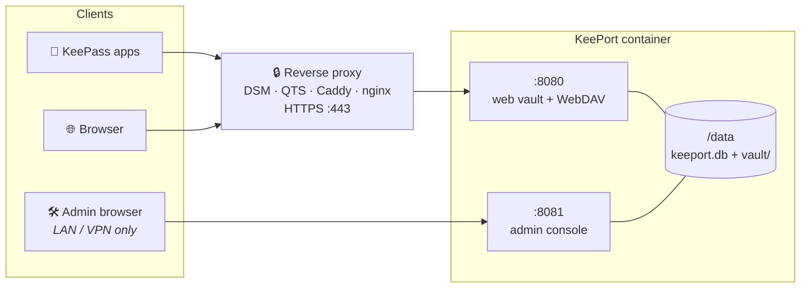

<div align="center">

# 🚀 KeePort Deployment Guide

**From zero to synced KeePass vaults on your Synology, QNAP or Linux server.**

[Synology](#-synology-dsm) · [QNAP](#-qnap-qts--quts-hero) · [Linux server](#-linux-server-caddy--nginx) · [Trusted proxies](#-trust-your-reverse-proxy) · [HTTPS required](#-secure-connection-required) · [First steps](#-first-steps-in-the-admin-console) · [KeePass apps](#-connect-keepass-apps) · [Updates](#-updating) · [Backups](#-backup--restore) · [Troubleshooting](#-troubleshooting)

</div>

---

## 🧭 Choose your path

| You run… | Follow | Effort |
|---|---|---|
| 🟦 **Synology NAS** with DSM 7.2 or later | [Synology DSM](#-synology-dsm) | ~15 minutes, SSH or Container Manager |
| 🟩 **QNAP NAS** with QTS 5 or QuTS hero | [QNAP](#-qnap-qts--quts-hero) | ~15 minutes, SSH |
| 🐧 **Linux server or VPS** with Docker | [Linux server](#-linux-server-caddy--nginx) | ~10 minutes, plus Caddy or nginx |

All paths use the same `docker-compose.yml` and end with the same [first steps in the admin console](#-first-steps-in-the-admin-console).

> [!IMPORTANT]
> Always install a **release** (for example `v0.22.0`), not the development branch. The latest version is listed on the [Releases page](https://github.com/madcoda9000/KeePort/releases). The examples below use `v0.22.0`.

## 🧩 How the pieces fit together



| Port | Serves | Who should reach it |
|---|---|---|
| `8080` (host port configurable) | Web vault, WebDAV, health check | Your devices — through HTTPS if anything leaves your LAN |
| `8081` | Admin console and admin API — **HTTPS** with a self-signed certificate | Only you, from your LAN or a VPN. **Never the internet.** |

### Who can reach the admin console?

`KEEPORT_ADMIN_BIND` decides on which network address of the host the admin port listens:

| `KEEPORT_ADMIN_BIND` | Admin console reachable from | Recommended for |
|---|---|---|
| `0.0.0.0` (default) | **Every network the host is connected to**: your whole home network (subnet), VPN and Docker networks — and the internet if the host has a public IP (VPS) or your router forwards the port | NAS at home behind a router |
| A LAN IP, e.g. `192.168.1.20` | Every device that can reach this IP — usually your whole home network | NAS with several network interfaces |
| A VPN IP, e.g. `10.8.0.1` | Only devices connected to that VPN | Remote administration |
| `127.0.0.1` | Only the host itself — from elsewhere via SSH tunnel | **Servers and VPS** |

> [!CAUTION]
> **Never make the admin console reachable from the internet.** Do not forward the admin port on your router and do not create a reverse proxy rule for it. On a server with a public IP (VPS), set `KEEPORT_ADMIN_BIND=127.0.0.1` or a VPN IP: Docker publishes ports past host firewalls such as `ufw` or `firewalld`, so a firewall rule on the host does **not** reliably block it.

### The admin certificate warning

The admin console uses HTTPS with a certificate that KeePort creates on first start (stored in `/data/tls/admin.pfx`, valid for 5 years, renewed automatically). It is not signed by a public authority, so your browser warns once — "Your connection is not private" / "Warning: Potential Security Risk". That is expected: choose **Advanced → Proceed** (Chrome/Edge) or **Advanced → Accept the Risk and Continue** (Firefox). The browser remembers the exception.

HTTPS is what makes your browser allow creating vaults ([why](#-secure-connection-required)). To make sure you are talking to your own KeePort, compare the fingerprint the browser shows (certificate details, SHA-256) with the one in the container log:

```bash
docker compose logs keeport | grep -i "fingerprint"   # with sudo on Synology
```

`KEEPORT_ADMIN_TLS_HOSTS` adds names or addresses to the certificate, e.g. `192.168.1.20, nas.local`. The warning stays — only a certificate from a trusted authority would remove it — but browsers then no longer complain about a name mismatch. If a reverse proxy terminates TLS for the admin console, set `KEEPORT_ADMIN_HTTPS=false` to serve plain HTTP on the admin port.

---

## 🟦 Synology DSM

> Tested layout for DSM 7.2+ with **Container Manager**. Menu names can differ slightly between DSM versions.

### 1. Prepare DSM

1. **Package Center** → install **Container Manager**. This also creates the shared folder `docker`.
2. **Control Panel → Terminal & SNMP** → enable **SSH service** (you can turn it off again afterwards).
3. Note your NAS's LAN IP, for example `192.168.1.20`.

### 2. Install KeePort

Connect with an account in the *administrators* group:

```bash
ssh your-user@192.168.1.20
cd /volume1/docker

# Download and unpack the release
curl -L https://github.com/madcoda9000/KeePort/archive/refs/tags/v0.22.0.tar.gz | tar xz
mv KeePort-0.22.0 keeport

# Data folder outside the app folder, writable by the container user (UID 1000)
sudo mkdir -p /volume1/docker/keeport-data
sudo chown -R 1000:1000 /volume1/docker/keeport-data

cd keeport
cp .env.example .env
vi .env
```

Set these values in `.env` (adjust the IP):

```dotenv
KEEPORT_DATA=/volume1/docker/keeport-data
KEEPORT_HTTP_HOST_PORT=8080
```

Build and start (the first build takes a few minutes):

```bash
sudo docker compose up -d --build
sudo docker compose logs keeport | grep -i "setup token"
```

> [!NOTE]
> On older DSM versions the command may be `sudo docker-compose` instead of `sudo docker compose`.

<details>
<summary><b>Prefer clicking? Install with Container Manager instead of SSH</b></summary>

1. Download `Source code (tar.gz)` of the release from the [Releases page](https://github.com/madcoda9000/KeePort/releases), unpack it on your computer and rename the folder to `keeport`.
2. In `keeport`, copy `.env.example` to `.env`. Leave `KEEPORT_DATA` at its default — the GUI cannot set the folder owner to UID 1000, so the data stays in a Docker volume.
3. **File Station** → upload the `keeport` folder into the shared folder `docker`.
4. **Container Manager → Project → Create**: project name `keeport`, path `/docker/keeport`, choose the existing `docker-compose.yml`, then **Next → Done**. Container Manager builds the image and starts the container.
5. **Container Manager → Container → keeport → Log**: look for the line with `setup token`.

With a Docker volume, use the backup command from [Backup & restore](#-backup--restore) instead of Hyper Backup.
</details>

### 3. Open the admin console

Open **`https://192.168.1.20:8081/admin`** — note the `https` — and accept the [certificate warning](#the-admin-certificate-warning) once. Enter the setup token and continue with [first steps](#-first-steps-in-the-admin-console).

Afterwards check **Admin → Settings → Data storage**: it must show **Host folder** with `/@syno/docker/keeport-data` (DSM's internal name for `/volume1/docker/keeport-data`). If it shows *Docker volume*, `KEEPORT_DATA` was not picked up — fix `.env` and [move the data](#move-data-from-the-docker-volume-to-a-folder).

The web vault is at `http://192.168.1.20:8080` for a first look. To **unlock vaults** in the web vault you need HTTPS ([why](#-secure-connection-required)) — set it up in the next step.

### 4. HTTPS with the DSM reverse proxy

Needed as soon as you use KeePort outside your LAN — and recommended inside it.

1. **Control Panel → Security → Certificate**: add a Let's Encrypt certificate for your domain, e.g. `vault.example.com` (requires that the domain points to your router and port 80/443 are forwarded).
2. **Control Panel → Login Portal → Advanced → Reverse Proxy → Create**:

   | Field | Value |
   |---|---|
   | Source protocol / hostname / port | `HTTPS` / `vault.example.com` / `443` |
   | Destination protocol / hostname / port | `HTTP` / `localhost` / `8080` |

3. **Control Panel → Security → Certificate → Settings**: assign the certificate to `vault.example.com`.
4. In `.env`, set `KEEPORT_COOKIE_SECURE=true`, then run `sudo docker compose up -d`.
5. Set `KEEPORT_TRUSTED_PROXIES=gateway` in `.env` and run `sudo docker compose up -d`, so KeePort sees each device's own IP address instead of the proxy's ([details](#-trust-your-reverse-proxy)).

Create a reverse proxy rule **only for the web vault** (port `8080`). The admin console stays in your LAN at `https://<nas-ip>:8081/admin` — never publish it.

### 5. Backups with Hyper Backup

Add the folder `docker/keeport-data` to a **Hyper Backup** task. For a fully consistent copy, stop KeePort while the backup runs — for example with two scheduled tasks in **Control Panel → Task Scheduler** (as `root`):

```bash
# before the backup window
docker stop keeport
# after the backup window
docker start keeport
```

---

## 🟩 QNAP QTS / QuTS hero

> Written for QTS 5.x / QuTS hero with **Container Station 3**. Menu names can differ slightly between firmware versions.

> [!WARNING]
> QTS uses port **8080** for its own web interface by default. Pick another host port for KeePort, such as `8090`, as shown below.

### 1. Prepare QTS

1. **App Center** → install **Container Station**. It creates the shared folder `Container`.
2. **Control Panel → Network & File Services → Telnet / SSH** → enable SSH.
3. Note your NAS's LAN IP, for example `192.168.1.30`.

### 2. Install KeePort

```bash
ssh admin@192.168.1.30
cd /share/Container

curl -L https://github.com/madcoda9000/KeePort/archive/refs/tags/v0.22.0.tar.gz | tar xz
mv KeePort-0.22.0 keeport

mkdir -p /share/Container/keeport-data
chown -R 1000:1000 /share/Container/keeport-data

cd keeport
cp .env.example .env
vi .env
```

Set these values in `.env`:

```dotenv
KEEPORT_DATA=/share/Container/keeport-data
KEEPORT_HTTP_HOST_PORT=8090
```

Build and start:

```bash
docker compose up -d --build
docker compose logs keeport | grep -i "setup token"
```

If `docker` is not found, open Container Station once so it finishes its setup, then reconnect via SSH.

### 3. Open the admin console

Open **`https://192.168.1.30:8081/admin`**, accept the [certificate warning](#the-admin-certificate-warning) once, enter the setup token and continue with [first steps](#-first-steps-in-the-admin-console). Then check that **Admin → Settings → Data storage** shows **Host folder** (`/Container/keeport-data` or similar). The web vault is at `http://192.168.1.30:8090`; unlocking vaults there needs HTTPS through the reverse proxy below ([why](#-secure-connection-required)). The container also shows up in Container Station, where you can see its logs and restart it.

### 4. HTTPS with the QTS reverse proxy

1. Set up a certificate for your domain in the QTS certificate settings (Let's Encrypt is supported; in QTS 5 under **Control Panel → Security → SSL Certificate & Private Key**).
2. **Control Panel → Network & File Services → Network Access → Reverse Proxy → Add**:

   | Field | Value |
   |---|---|
   | Source | `HTTPS`, domain `vault.example.com`, port `443` |
   | Destination | `HTTP`, `localhost`, port `8090` |

3. In `.env`, set `KEEPORT_COOKIE_SECURE=true`, then run `docker compose up -d`.
4. Set `KEEPORT_TRUSTED_PROXIES=gateway` in `.env` and run `docker compose up -d`, so KeePort sees each device's own IP address instead of the proxy's ([details](#-trust-your-reverse-proxy)).

As on Synology: no reverse proxy rule for the admin port. It stays in your LAN at `https://<nas-ip>:8081/admin`; for remote administration use QNAP's **QVPN Service**.

### 5. Backups with Hybrid Backup Sync

Add `Container/keeport-data` to a **Hybrid Backup Sync** job. For a fully consistent copy, run `docker stop keeport` before and `docker start keeport` after the job (for example via a cron entry on the NAS).

---

## 🐧 Linux server (Caddy / nginx)

For a home server or VPS with Docker Engine and the Compose v2 plugin.

```bash
git clone --branch v0.22.0 https://github.com/madcoda9000/KeePort.git
cd KeePort
cp .env.example .env
docker compose up -d --build
docker compose logs keeport | grep -i "setup token"
```

The admin console listens on all addresses of the host by default (`https://<server>:8081/admin`). **On a server with a public IP, restrict it first:** set `KEEPORT_ADMIN_BIND=127.0.0.1` in `.env`, run `docker compose up -d`, and reach it through an SSH tunnel:

```bash
ssh -L 8081:127.0.0.1:8081 user@your-server
# then open https://localhost:8081/admin and accept the certificate warning once
```

To keep data in a folder instead of a Docker volume, set `KEEPORT_DATA=/srv/keeport/data` in `.env` and prepare it with `sudo mkdir -p /srv/keeport/data && sudo chown -R 1000:1000 /srv/keeport/data`.

Terminate TLS in a reverse proxy, forward the vault host to `127.0.0.1:8080`, set `KEEPORT_COOKIE_SECURE=true` and — for a proxy on the same host — `KEEPORT_TRUSTED_PROXIES=gateway` ([details](#-trust-your-reverse-proxy)).

<details>
<summary><b>Caddy</b> — automatic HTTPS</summary>

```caddy
vault.example.com {
    reverse_proxy 127.0.0.1:8080
}

# Optional: admin console only from LAN/VPN networks (with KEEPORT_ADMIN_HTTPS=false)
admin.example.com {
    @not_vpn not remote_ip 192.168.1.0/24 10.0.0.0/8
    respond @not_vpn 404
    reverse_proxy 127.0.0.1:8081
}
```
</details>

<details>
<summary><b>nginx</b></summary>

```nginx
server {
    listen 443 ssl;
    server_name vault.example.com;

    # ssl_certificate / ssl_certificate_key from your ACME client

    client_max_body_size 50m;   # room for vaults with attachments

    location / {
        proxy_pass http://127.0.0.1:8080;
        proxy_set_header Host $host;
        proxy_set_header X-Forwarded-For $proxy_add_x_forwarded_for;
        proxy_set_header X-Forwarded-Proto $scheme;
    }
}
```
</details>

Keep `/admin` and `/api/admin` off the public vault host. If you must share one hostname, route those paths to port `8081` and restrict them with IP allowlists or VPN-only access.

---

## 🔐 Secure connection required

KeePort encrypts and decrypts vaults in the browser with the Web Crypto API. Browsers only provide it in a **secure context**: pages served over **HTTPS**, or from **`http://localhost`**. Over plain `http://` with an IP address or host name (e.g. `http://192.168.1.20:8080`) it is missing, so KeePort disables these actions and shows a "Secure connection required" notice — on the web vault's sign-in page, when unlocking a vault, and in the admin console's "Create a vault" card:

| Needs a secure connection | Works over plain HTTP |
|---|---|
| Create KDBX (admin console — served over HTTPS by default, so this works out of the box) | Sign-in, users, permissions, WebDAV credentials, settings, logs |
| Unlock, edit and save vaults (web vault) | Uploading and downloading `.kdbx` files |

KeePass apps syncing via WebDAV are not affected — they encrypt on the device.

Ways to get a secure connection:

| Option | How |
|---|---|
| **Web vault: HTTPS through your reverse proxy** | See the HTTPS steps for [Synology](#4-https-with-the-dsm-reverse-proxy), [QNAP](#4-https-with-the-qts-reverse-proxy) or [Caddy/nginx](#-linux-server-caddy--nginx). The web vault has no HTTPS of its own. |
| **Admin console: built-in HTTPS** (default) | Open `https://<host>:<admin port>/admin` and accept the [certificate warning](#the-admin-certificate-warning). Only if you set `KEEPORT_ADMIN_HTTPS=false` do you need HTTPS from a reverse proxy instead. |
| **SSH tunnel to `localhost`** | `localhost` counts as secure, e.g. `ssh -L 8080:127.0.0.1:8080 user@<host>`, then `http://localhost:8080`. |
| **Create the vault elsewhere** | Create the `.kdbx` in KeePassXC or a mobile KeePass app and upload it under **Vault files → Upload a vault**. |

## 🛰️ Trust your reverse proxy

A reverse proxy forwards every request to KeePort itself and passes the device's real address in the `X-Forwarded-For` header. KeePort only believes that header from proxies you list in `KEEPORT_TRUSTED_PROXIES`. Without the entry, KeePort sees the **proxy's** address for every device: the WebDAV log shows that address, and all devices share one rate-limit quota.

The proxy usually does **not** connect from `127.0.0.1`, even when it runs on the same NAS or server: requests reach the container through Docker's network, from the network's gateway address (for example `172.22.0.1`). That address can change whenever the network is recreated, e.g. after `docker compose down`.

### Proxy on the same NAS or server (Synology, QNAP, Caddy/nginx on the host)

Use the keyword `gateway`. KeePort looks up its current Docker gateway on every start and trusts exactly that one address — no need to look it up or update it later.

```dotenv
KEEPORT_TRUSTED_PROXIES=gateway
```

```bash
docker compose up -d   # with sudo on Synology
```

Check the container log: it shows the resolved address,

```text
Accepting X-Forwarded-For/-Proto from: loopback, 172.22.0.1 (gateway)
```

and after a sync, **Admin → Logs → WebDAV logs** shows each device's own address instead of `172.x.0.1`.

### Devices at home show your own public IP

If a phone in your Wi-Fi shows your **own public IP address** in the WebDAV log (the one your provider gives your router), the proxy setting is working. The address comes from the way the request travels:

1. The device uses the public name, e.g. `vault.example.com`, even at home. DNS returns your public IP.
2. The request goes to your router, which forwards it back to the NAS (*NAT reflection* or *hairpin NAT*). On the way, the router replaces the device's address with its own public one.
3. The reverse proxy only sees that address and passes it on to KeePort.

On mobile data the log shows the device's real address. As long as the router rewrites the address, all devices at home also share one [rate-limit](#-troubleshooting) quota.

**Fix: local DNS (split DNS).** Let your home network resolve the public name to the NAS's LAN address, e.g. `192.168.1.20`. Devices at home then connect to the NAS directly, and the log shows their LAN addresses:

- **OPNsense / pfSense:** **Services → Unbound DNS → Overrides** (OPNsense) or **Services → DNS Resolver → Host Overrides** (pfSense), add the name with the NAS's LAN IP.
- **Pi-hole / AdGuard Home:** add a local DNS record (*Local DNS → DNS Records* or *Filters → DNS rewrites*).
- **Routers without this option** (e.g. FRITZ!Box): use Pi-hole or AdGuard Home as the DNS server of your network.

The HTTPS certificate stays valid because the name does not change, so nothing has to be changed in the apps. Android's **Private DNS** (*Settings → Network → Private DNS*) bypasses your local DNS server; set it to *Automatic* or *Off* on devices that should use the override.

### Proxy on another machine or in another container

List the address the proxy connects from:

1. Open KeePort once through the proxy (for example sync a KeePass app).
2. Read the **Client IP** of that request in **Admin → Logs → WebDAV logs**. The container log names it, too:

   ```text
   Ignored X-Forwarded-For from 192.168.1.10: it is not a trusted proxy … add it to KEEPORT_TRUSTED_PROXIES.
   ```

3. Add it to `.env`, e.g. `KEEPORT_TRUSTED_PROXIES=192.168.1.10`, and run `docker compose up -d`.

Several entries are separated by commas and can be combined with `gateway`; networks use CIDR notation, e.g. `gateway, 192.168.1.10, 10.10.0.0/16`. Loopback is always trusted.

> [!WARNING]
> List only your proxy, not whole networks such as your LAN or `172.16.0.0/12`. Every trusted address can claim any client address — a device in a trusted network could fake its IP and bypass the rate limits that slow down password guessing. KeePort refuses to start with `0.0.0.0/0` or `::/0`.

> [!NOTE]
> Chained proxies (e.g. Cloudflare in front of the NAS proxy) are not supported yet; only the last hop is evaluated. `gateway` only works inside the Docker container; outside Docker KeePort refuses to start with it.

---

## 👣 First steps in the admin console

1. **Create the administrator** with the setup token from the log. The token works only once.
2. **Users → Create a user** for every person. Admin accounts can only use the admin console; the web vault and WebDAV need a regular user.
3. **Vault files** → create a new vault in the browser or upload an existing `.kdbx`.
4. **Permissions** on each vault → `Read only` or `Read and write` per user.
5. **WebDAV credentials** → one app password per device (for example "Pixel 8" or "iPhone").

After signing in, the admin console opens on the **Dashboard**. It shows whether KeePort runs, its version and uptime, the container's addresses and ports, the admin certificate, where the data is stored, the number of vaults, accounts and conflict copies, successful and failed sign-ins of the last 24 hours and 7 days, and WebDAV activity. A **Needs attention** box lists what to look at, such as conflict copies, data outside a host folder or failed admin sign-ins. KeePort only counts sign-ins and keeps the counts for 30 days. It stores no names or IP addresses. Docker's own status is not visible from inside the container. Use an external monitor if you need to know when the whole container is down.

Users now sign in to the web vault with their account and unlock vaults with the vault's master password, which never leaves the browser.

## ✉️ E-mail (optional)

KeePort can send e-mails through any SMTP server — your own mail server, Synology MailPlus, your provider's mailbox or a service such as Brevo or Mailjet. With e-mail set up, KeePort can:

- **invite** new users: they choose their own password through a link, so the administrator never knows it;
- send **"Forgot password?"** links to users (never to administrators);
- **confirm** e-mail addresses with a 6-digit code;
- **notify** users about sign-ins from a new browser, password changes, a changed e-mail address and new WebDAV app passwords;
- **warn** administrators about many failed sign-ins, an expiring admin certificate, data outside a host folder and low disk space.

Set it up in **Admin → Settings → E-mail**:

| Field | Example |
|---|---|
| SMTP server / Port / Security | `smtp.example.com`, `587` with **STARTTLS**, or `465` with **SSL/TLS** |
| Username / Password | The mailbox or SMTP credentials, if the server needs them. The password is stored encrypted (key in `/data/keys`) and never shown again. |
| Sender address / name | `keeport@example.com`, `KeePort` |
| Web vault address | `https://vault.example.com` — links in e-mails point here. It must be reachable from where users open their mail; never enter the admin console. |

Click **Send test e-mail** to check the settings; the server's answer is shown if it fails. E-mails go through a queue and are retried after 1, 5, 15 and 60 minutes. E-mails never contain passwords or vault content — links carry one-time tokens only (invitation 48 hours, password reset 30 minutes), and those are part of the address after `#`, so they do not reach the reverse proxy's logs.

Users confirm their address in the web vault under **Profile**; administrators in the admin console under **Profile**. Only confirmed addresses get notifications, warnings and reset links.

## 🔐 Two-factor sign-in

Every account can protect its sign-in with a second factor under **Profile → Two-factor sign-in**:

- **Authenticator app** (TOTP): scan the QR code with Aegis, 2FAS, Google Authenticator, KeePassXC or a similar app, then enter one code to turn it on.
- **Codes by e-mail**: a 6-digit code goes to the confirmed address at each sign-in. Needs [e-mail](#-e-mail-optional). E-mail is weaker than an app, so by default only users may use it, not administrators.
- **10 recovery codes** are shown once when the first factor is turned on. Each works once; new ones can be created in the profile.

WebDAV is not affected: KeePass apps keep signing in with their app passwords.

**Admin → Settings → Two-factor sign-in** sets the rules: whether administrators and/or users **must** set up a second factor (accounts without one see only the setup after signing in), and who may use codes by e-mail. **Users** shows who uses two-factor sign-in; **Reset 2FA** turns it off for an account that lost its phone and signs it out everywhere.

A user who forgot the password and uses an authenticator app needs a code from it (or a recovery code) as well as the reset link.

### Passkeys

Users and administrators can add **passkeys** under **Profile → Two-factor sign-in**: fingerprint, face or device PIN, a password manager with passkeys, or a security key. A passkey signs in on its own (**Sign in with a passkey**, no username or password), and after a password it counts as second factor — accounts with a passkey can no longer sign in with the password alone.

Browsers offer passkeys only on a **domain name with HTTPS** (or `localhost`), never on an IP address. Behind your reverse proxy (`https://vault.example.com`) they work without any setting. The admin console on `https://192.168.1.20:8081` with its self-signed certificate shows a short note instead; it gets passkeys only if you reach it under a name with a valid certificate.

A passkey belongs to the domain it was created on. If you later move KeePort to another domain, add the passkeys again. If your reverse proxy hides the domain from KeePort (passkeys fail with "could not be checked"), set `KEEPORT_PASSKEY_RP_ID` and `KEEPORT_PASSKEY_ORIGINS` ([configuration](#️-configuration-reference)).

### Locked out as the only administrator

If the only administrator lost both the phone and the recovery codes, turn two-factor sign-in off from the container's command line:

```bash
docker compose exec keeport keeport-admin reset-mfa <username>
# or, without the compose folder (e.g. Synology over SSH):
sudo docker exec keeport keeport-admin reset-mfa <username>
```

The account is signed out everywhere and can sign in with the password alone; the reset appears in the audit log. Set up a second factor again right away.

## 📱 Connect KeePass apps

| Setting | Value |
|---|---|
| Server / URL | `https://vault.example.com/webdav` (or `http://<nas-ip>:<port>/webdav` in the LAN) |
| Username | The generated WebDAV username from **WebDAV credentials** |
| Password | The WebDAV app password — **not** the vault master password |

| App | Platform | Notes |
|---|---|---|
| **KeePass2Android** | Android | Connects directly via WebDAV. Saving, syncing and merging verified on a device. |
| **KeePassium** | iOS / iPadOS | Direct WebDAV connection ([guide](https://support.keepassium.com/kb/sync-webdav/)). Editing and syncing verified on a device. |
| **KeePassDX** | Android | Uses Android's file picker; add KeePort in a provider such as [DAVx⁵ WebDAV Mounts](https://manual.davx5.com/webdav_mounts.html). Not yet verified. |

> [!TIP]
> Create **one app password per device**. KeePort remembers which version each app password downloaded last and uses it to detect stale saves.

<details>
<summary><b>How KeePort protects against overwrites (technical details)</b></summary>

- Every vault has a revision and an ETag. Clients that send `If-Match` are checked against it. Clients that never send it, such as KeePass2Android, are checked against the version their app password last downloaded with `GET`. Without either, KeePort answers `428` and stores nothing.
- A stale save never overwrites the vault: KeePort answers `412` (REST: `409`) and keeps the submitted file as `<name>.conflict-<UTC timestamp>-<client>-<id>.kdbx` without access grants. Administrators can download, share or delete it in **Vault files**.
- Transactional saves are supported: a `PUT` to `<vault>.kdbx.tmp.<suffix>` or `<vault>_tmp_<suffix>.kdbx` is held for up to 15 minutes (at most 4 per app password) and only becomes the vault when the client sends `MOVE` onto exactly that vault. `MOVE` cannot rename vaults and `DELETE` on a vault is forbidden.
- KeePort does not keep server-side WebDAV locks. `LOCK` returns a token that is not stored and `UNLOCK` returns `204`; ETags are the conflict protection.
- Every WebDAV request is logged (method, path, status, credential, client IP, `If-Match`, `Depth`, `Destination`, `Overwrite`, size, duration — never passwords or file contents). Admins see the latest 5,000 under **Logs → WebDAV logs**.
</details>

## 🔄 Updating

Read the [changelog](../CHANGELOG.md) and make a [backup](#-backup--restore) first. Your `.env` and data are kept.

**Synology / QNAP — with the update script (recommended):**

```bash
cd /volume1/docker                         # QNAP: cd /share/Container
sudo bash keeport/scripts/keeport-update.sh          # latest release
sudo bash keeport/scripts/keeport-update.sh v0.22.0   # or a specific one
```

On QNAP, prefix the command with `BASE_DIR=/share/Container`. The script:

1. Finds the latest release on GitHub (including pre-releases), or uses the version you pass.
2. Reads `KEEPORT_DATA` from your `.env` and warns if your data is in a Docker volume ([why that matters](#move-data-from-the-docker-volume-to-a-folder)).
3. Stops KeePort and backs up the data to `keeport-backups/keeport-data-v<old>-<time>.tgz`.
4. Moves the old version to `keeport-old-v<old>-<time>`, unpacks the new release as `keeport`, and keeps your `.env` and data.
5. Rebuilds and starts KeePort and waits until it reports healthy. **If the build fails or the container does not become healthy, it restores the previous version automatically.**

It never deletes anything — it prints the cleanup commands at the end. Set `YES=1` to skip the confirmation prompt, e.g. in a scheduled task (for a password manager, updating by hand after reading the changelog is the safer habit).

<details>
<summary><b>Synology / QNAP — by hand</b></summary>

```bash
cd /volume1/docker                # QNAP: cd /share/Container
mv keeport keeport-old
curl -L https://github.com/madcoda9000/KeePort/archive/refs/tags/v0.22.0.tar.gz | tar xz
mv KeePort-0.22.0 keeport
cp keeport-old/.env keeport/
cd keeport
sudo docker compose up -d --build # QNAP: without sudo
```

Delete `keeport-old` once everything works. If you installed via Container Manager without SSH, upload the new release folder the same way and rebuild the project.
</details>

**Linux server:**

```bash
cd KeePort
git fetch --tags
git checkout v0.22.0
docker compose up -d --build
```

## 💾 Backup & restore

KeePort keeps everything in `/data`. **Admin → Settings → Data storage** shows where that is on the host: a **host folder** (set via `KEEPORT_DATA`, included in NAS backups) or a **Docker volume** (the default without `KEEPORT_DATA`, which NAS backup tools don't see). While the data is in a Docker volume or not mounted at all, the admin console shows a warning on every page, and the container log warns on every start.

| Path | Contents |
|---|---|
| `keeport.db` | Users, sessions, vault metadata, permissions, WebDAV credential hashes, settings, WebDAV logs |
| `vault/` | The encrypted `.kdbx` files |
| `vault-versions/` | Earlier versions of each vault, kept on every save (by default 30 per vault, at most 90 days; **Admin → Settings → Vault versions**). Plan for up to 30 times the size of your vaults — usually only a few MB. |
| `tls/` | The admin console's self-signed certificate |
| `keys/` | The key that encrypts the stored SMTP password and the authenticator app secrets. Without it, enter the SMTP password again after a restore, and accounts with an authenticator app must sign in with a recovery code (or an administrator resets their two-factor sign-in). |

- **Data in a folder** (`KEEPORT_DATA=/path`): back up that folder with your usual tool — Hyper Backup, Hybrid Backup Sync, restic, borg — ideally while KeePort is stopped.
- **Data in the Docker volume** (default): stop the container and archive the volume:

  ```bash
  docker compose stop keeport
  docker run --rm \
    -v keeport_keeport-data:/data:ro \
    -v "$PWD/backups:/backup" \
    alpine tar czf /backup/keeport-$(date +%F).tgz -C /data .
  docker compose start keeport
  ```

To restore, stop KeePort, put the files back into the data folder or a fresh volume, make sure they belong to UID/GID `1000:1000`, and start KeePort again.

> [!TIP]
> Your `.kdbx` files are ordinary KeePass files. Downloading them now and then from **Vault files** gives you an extra copy that any KeePass app can open.

### Move data from the Docker volume to a folder

If **Admin → Settings → Data storage** shows *Docker volume* — typically because `KEEPORT_DATA` was missing from `.env` during installation — move the data into a folder so Hyper Backup or Hybrid Backup Sync can include it. Example for Synology (QNAP: `/share/Container/…`, without `sudo`):

```bash
cd /volume1/docker/keeport

# 1. Stop KeePort
sudo docker compose stop

# 2. Copy the volume's contents into the folder and hand it to the container user
sudo mkdir -p /volume1/docker/keeport-data
sudo docker run --rm -v keeport_keeport-data:/from:ro -v /volume1/docker/keeport-data:/to alpine sh -c 'cp -a /from/. /to/'
sudo chown -R 1000:1000 /volume1/docker/keeport-data
sudo ls -la /volume1/docker/keeport-data      # keeport.db, vault/ and tls/ must be there
```

3. Set the folder in `.env` (an absolute path, without `#` in front):

   ```dotenv
   KEEPORT_DATA=/volume1/docker/keeport-data
   ```

4. Start KeePort and check that the folder is used — the output must read `bind /volume1/docker/keeport-data -> /data`:

   ```bash
   sudo docker compose up -d
   sudo docker inspect -f '{{range .Mounts}}{{.Type}} {{.Source}} -> {{.Destination}}{{"\n"}}{{end}}' keeport
   ```

5. Check that users, vaults and WebDAV credentials are still there and that a KeePass app still syncs. **Only then** remove the old volume: `sudo docker volume rm keeport_keeport-data`.

Use an absolute path for `KEEPORT_DATA`. A relative path such as `./keeport-data` is relative to the folder with `docker-compose.yml` and therefore ends up **inside** the KeePort folder, not next to it.

## ⚙️ Configuration reference

| Variable in `.env` | Default | Purpose |
|---|---|---|
| `KEEPORT_HTTP_HOST_PORT` | `8080` | Host port for the web vault and WebDAV. Use e.g. `8090` on QNAP. |
| `KEEPORT_DATA` | `keeport-data` | Docker volume name, or a folder for a bind mount (must belong to UID 1000). Use an absolute path; `./…` is relative to the KeePort folder. Check the result in **Admin → Settings → Data storage**. |
| `KEEPORT_ADMIN_BIND` | `0.0.0.0` | Host address for the admin port — every network of the host by default; `127.0.0.1` or a VPN IP on servers with a public IP. See [who can reach the admin console](#who-can-reach-the-admin-console). |
| `KEEPORT_ADMIN_HTTPS` | `true` | Serve the admin console over HTTPS with a self-signed certificate. `false` if a reverse proxy does TLS. |
| `KEEPORT_ADMIN_TLS_HOSTS` | *(empty)* | Extra names/IPs for the admin certificate, comma-separated, e.g. `192.168.1.20, nas.local`. |
| `KEEPORT_FAVICON_DOWNLOAD` | `true` | Lets users store a website's icon in a vault entry ("Save website icon"). KeePort then fetches the icon once from the public site, only over HTTPS and never from addresses in your network. Set to `false` if the server has no internet access or must not contact other sites. |
| `KEEPORT_ADMIN_HOST_PORT` | `8081` | Host port for the admin console. The container side is always `8081`. |
| `KEEPORT_COOKIE_SECURE` | `false` | Set to `true` once KeePort is served over HTTPS (`yes`/`no` also work). |
| `KEEPORT_PASSKEY_RP_ID` / `KEEPORT_PASSKEY_ORIGINS` | *(empty: the page's domain)* | Only if passkeys fail behind your proxy: the domain (e.g. `vault.example.com`) and the address(es) users open (e.g. `https://vault.example.com`, comma-separated). |
| `KEEPORT_TRUSTED_PROXIES` | *(empty: loopback only)* | Reverse proxies whose `X-Forwarded-For` is accepted — `gateway` for a proxy on the same host, or IPs/CIDR networks, comma-separated. See [Trust your reverse proxy](#-trust-your-reverse-proxy). |

After changing `.env`, run `docker compose up -d` (with `sudo` on Synology).

### Request limits

Sign-in and first-run setup share a limit of **10 requests per minute per IP**; session checks and sign-out are exempt. WebDAV has its own limit of **60 requests per minute per IP**, applied before authentication. Change both at runtime in **Admin → Settings**; they are stored in SQLite and apply immediately. A `429 Too Many Requests` response includes `Retry-After`.

Limits apply per client address. Behind a reverse proxy, [trust the proxy](#-trust-your-reverse-proxy) — otherwise all devices share one quota.

## 🧯 Troubleshooting

| Symptom | What to do |
|---|---|
| "Secure connection required" or `randomBytes is not a function` | The page was opened over plain `http://` with an IP or host name. Use HTTPS or an SSH tunnel to `localhost` ([details](#-secure-connection-required)). |
| Data folder is empty in File Station, but the admin console shows vaults | The data is in a Docker volume because `KEEPORT_DATA` is not set. **Admin → Settings → Data storage** confirms it; [move it to a folder](#move-data-from-the-docker-volume-to-a-folder). |
| Container restarts again and again | Read the first lines of the log (`sudo docker compose logs keeport`, or **Container Manager → Container → keeport → Log**). A line starting with `KeePort cannot start:` names the setting in `.env` to fix. |
| No `setup token` in the log | An administrator already exists. Sign in at `/admin`. |
| `KeePort cannot write to data directory` on start | The data folder must belong to UID/GID `1000:1000` (`chown -R 1000:1000 <folder>`). |
| Port 8080 already in use (QNAP) | Set `KEEPORT_HTTP_HOST_PORT=8090` and run `docker compose up -d`. |
| Admin console returns `404` on port 8080 | Expected — the admin console only answers on the admin port (`8081`). |
| Admin console not reachable from your PC | Use **`https://`** — plain `http://` to the admin port fails ("connection reset", "sent an invalid response"). Check `KEEPORT_ADMIN_BIND` and that the admin host port matches. |
| Browser warns "connection is not private" on the admin console | Expected with the self-signed certificate — accept it once ([details](#the-admin-certificate-warning)). |
| Signed out right after signing in | You open KeePort over plain HTTP while `KEEPORT_COOKIE_SECURE=true`. Use the HTTPS address, or set it to `false` for LAN-only HTTP. |
| A KeePass app cannot save | Open **Logs → WebDAV logs** and check the `PUT`/`MOVE` right after the attempt: `404` on a temporary name = unknown naming pattern, `428` = the app neither sent `If-Match` nor downloaded the vault first, `412` = the vault changed on the server. |
| `412 Precondition Failed` | Someone saved in between. In KeePass2Android choose **Merge**; an admin can provide the conflict copy if needed. |
| `428 Precondition Required` | Reopen the vault from the server in the app, then save again. |
| `429 Too Many Requests` | Wait for `Retry-After`. If all devices show the same address in the WebDAV log, [trust your reverse proxy](#-trust-your-reverse-proxy); otherwise raise the limits in **Admin → Settings**. |
| All devices show the same Client IP in the WebDAV log | That is your reverse proxy. Set `KEEPORT_TRUSTED_PROXIES=gateway` if it runs on the same host, otherwise add its address ([how](#-trust-your-reverse-proxy)). |
| Devices in your Wi-Fi show your own public IP in the WebDAV log | Your router sends the requests back in (NAT reflection) and replaces the address. Set up local DNS for the public name ([how](#devices-at-home-show-your-own-public-ip)). |
| No "Sign in with a passkey" button, or "Passkeys need the address with a domain name" | Open KeePort with its domain name over HTTPS, not with an IP address ([details](#passkeys)). |
| Lost phone, no recovery codes left | An administrator clicks **Reset 2FA** in **Users**. If you are the only administrator, run `keeport-admin reset-mfa <username>` in the container ([how](#locked-out-as-the-only-administrator)). |
| `KeePort cannot start: invalid KEEPORT_TRUSTED_PROXIES` | Fix the named entry: use `gateway` (only inside Docker), single IPs or CIDR networks such as `10.10.0.0/16`; catch-all entries like `0.0.0.0/0` are refused. |

## 🔍 What the server can and cannot see

| KeePort sees | KeePort never sees |
|---|---|
| Encrypted `.kdbx` bytes | Master passwords and key files |
| File names, sizes, revisions, timestamps | Entry titles, usernames, passwords |
| Users, permissions, WebDAV app password hashes | URLs, notes, TOTP secrets, attachments |
| WebDAV request metadata (see logs) | Anything inside the vault — decryption happens only in the browser or the KeePass app |
